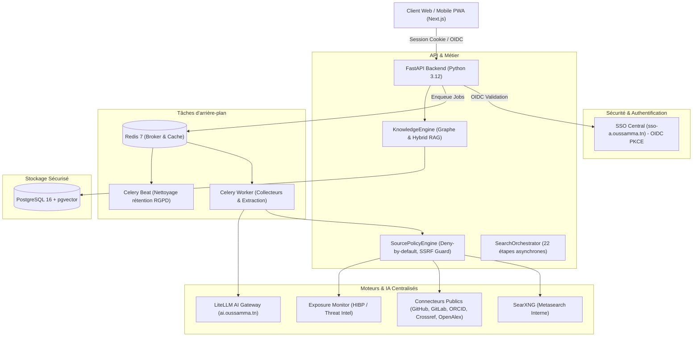

# Architecture Technique — People OSINT

`people.oussamma.tn` est une application d'investigation OSINT multi-sources, intégrant une base de connaissances relationnelle et vectorielle, un graphe interactif Cytoscape.js et un assistant conversationnel IA connecté à LiteLLM.

## Vue d'ensemble de l'architecture

## Principes Directeurs
1. **SSO Strict & Accès Initial SUPER_ADMIN Uniquement :**
   Aucun compte libre. Par défaut, tout utilisateur authentifié est en statut `PENDING` (403 Forbidden). Seul le `INITIAL_SUPERADMIN_SUB` configuré est promu automatiquement.
2. **Réutilisation des Services Centraux :**
   Aucune duplication de SSO ou de LiteLLM. L'application réutilise les instances de production `sso-a.oussamma.tn` et `ai.oussamma.tn`.
3. **Sécurité et Protection SSRF :**
   Validation systématique de la destination de chaque requête HTTP vers l'extérieur pour bloquer les adresses privées, loopback et métadonnées cloud (169.254.169.254).
4. **GraphRAG Applicatif :**
   Les entités et relations sont stockées dans PostgreSQL avec leurs preuves et niveaux d'incertitude. Le LLM n'exécute jamais de SQL arbitraire ; il appelle des outils prédéfinis sécurisés.
