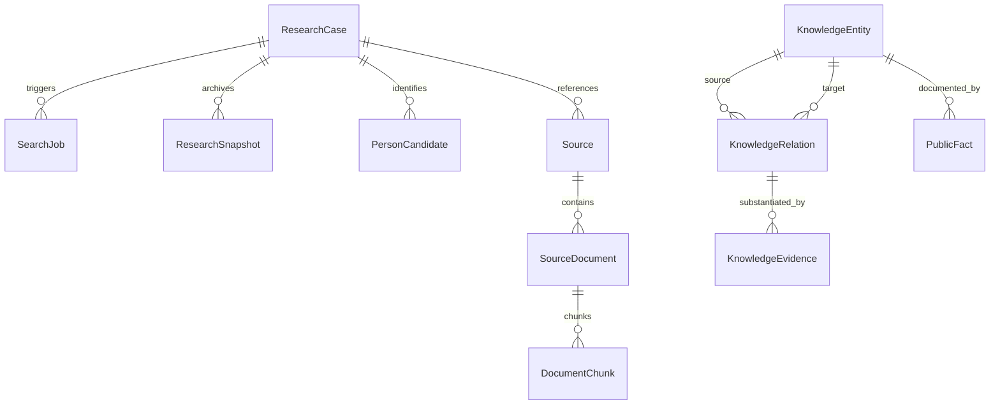

# Base de Connaissances & Modèle de Données — People OSINT

La base de connaissances structure les informations extraites pour éviter la perte de données entre les recherches et permettre leur réutilisation.

## Modèle Entités-Relations

## Types d'Entités Autorisées
- `Person` : Personne physique cible ou associée
- `Organization` : Entreprise, laboratoire, université
- `Project` : Dépôt de code, projet open source, initiative
- `Publication` : Article de recherche, livre, brevet
- `Document` : Document public ou page institutionnelle
- `PublicProfile` : Profil officiel public (ex: @user sur GitHub)
- `Source` : URL et domaine d'extraction

## Relations Professionnelles & Preuves
- `WORKED_AT` : Emploi documenté dans une organisation
- `CONTRIBUTED_TO` : Contribution documentée à un projet ou code
- `COAUTHORED_WITH` : Co-signature documentée d'un article
- `MEMBER_OF` : Appartenance vérifiée à un groupe public
- `PARTICIPATED_IN` : Participation à une conférence ou événement
- `AFFILIATED_WITH` : Affiliation institutionnelle ou académique
- `DECLARED_CONNECTION` : Lien déclaré publiquement par l'intéressé

Chaque relation possède :
- Son indice d'incertitude (de 0.0 certain à 1.0 incertain)
- Sa nature : `DOCUMENTED`, `DECLARED`, `UNCERTAIN`
- Ses preuves textuelles exactes (`KnowledgeEvidence`)
- Sa date d'expiration éventuelle pour conformité à la rétention.
