# Cycle de Recherche Multi-Sources — People OSINT

L'orchestrateur `SearchOrchestrator` applique rigoureusement le cycle en 22 étapes :

```mermaid
flowchart TD
    A["1. Vérification Session SSO"] --> B["2. Vérification Accès Applicatif (ACTIVE)"]
    B --> C["3. Vérification des Quotas"]
    C --> D["4. Validation des Critères"]
    D --> E["5. Consultation des Résultats Existants"]
    E --> F["6. Création ou Actualisation du Dossier"]
    F --> G["7. Construction du Plan de Recherche"]
    G --> H["8. Sélection des Connecteurs Autorisés (PolicyEngine)"]
    H --> I["9. Exécution Asynchrone des Requêtes"]
    I --> J["10. Normalisation des Données"]
    J --> K["11. Déduplication des URLs & Filtrage SSRF"]
    K --> L["12. Extraction des Informations Autorisées"]
    L --> M["13. Résolution des Candidats Distincts (Homonymes)"]
    M --> N["14. Extraction des Faits Sourcés"]
    N --> O["15. Identification des Relations Explicites"]
    O --> P["16. Analyse Sémantique LiteLLM"]
    P --> Q["17. Enregistrement des Sources & Documents"]
    Q --> R["18. Indexation Vectorielle"]
    R --> S["19. Mise à Jour du Graphe de Connaissances"]
    S --> T["20. Enregistrement du Snapshot Horodaté"]
    T --> U["21. Génération de la Synthèse Analytique"]
    U --> V["22. Restitution à l'Utilisateur (Statut COMPLETED)"]
```

## Modes et Profondeurs
- **Modes :**
  - `PROFESSIONAL` : GitHub, GitLab, ORCID, Crossref, OpenAlex, SearXNG
  - `FULL_WEB` : SearXNG, Médias, Web public
- **Profondeurs :**
  - `QUICK` : Sources directes de référence
  - `DEEP` : Profilage approfondi des dépôts et co-auteurs
  - `EXTENDED` : Graphe étendu et publications liées
