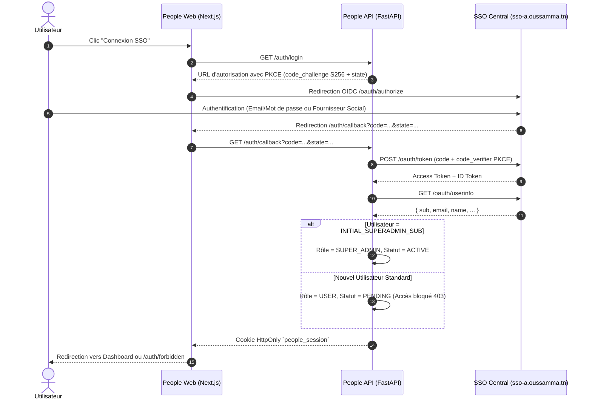

# Authentification SSO — People OSINT

L'application délègue intégralement l'authentification au serveur SSO central existant :
`https://sso-a.oussamma.tn/`

## Flux d'Authentification OpenID Connect (PKCE S256)



## Règles d'Accès Initiales (Exigence 3.1)
- **Deny-by-Default :** Aucun accès n'est accordé automatiquement.
- Tout compte nouvellement authentifié reçoit le statut `PENDING`.
- Les utilisateurs en statut `PENDING` reçoivent un code HTTP `403 Forbidden` sur l'ensemble des routes métier de l'API et sont redirigés vers `/auth/forbidden` sur le frontend.
- Seul le Super Administrateur peut promouvoir un compte au statut `ACTIVE` depuis le panneau d'administration `/admin`.

## Variables d'Environnement
```dotenv
OIDC_ISSUER=https://sso-a.oussamma.tn/
OIDC_CLIENT_ID=client_people_osint
OIDC_CLIENT_SECRET=sec_people_osint_platform_secret_2026
OIDC_REDIRECT_URI=https://people.oussamma.tn/auth/callback
INITIAL_SUPERADMIN_ISSUER=https://sso-a.oussamma.tn
INITIAL_SUPERADMIN_SUB=votre-sso-sub-unique
```
